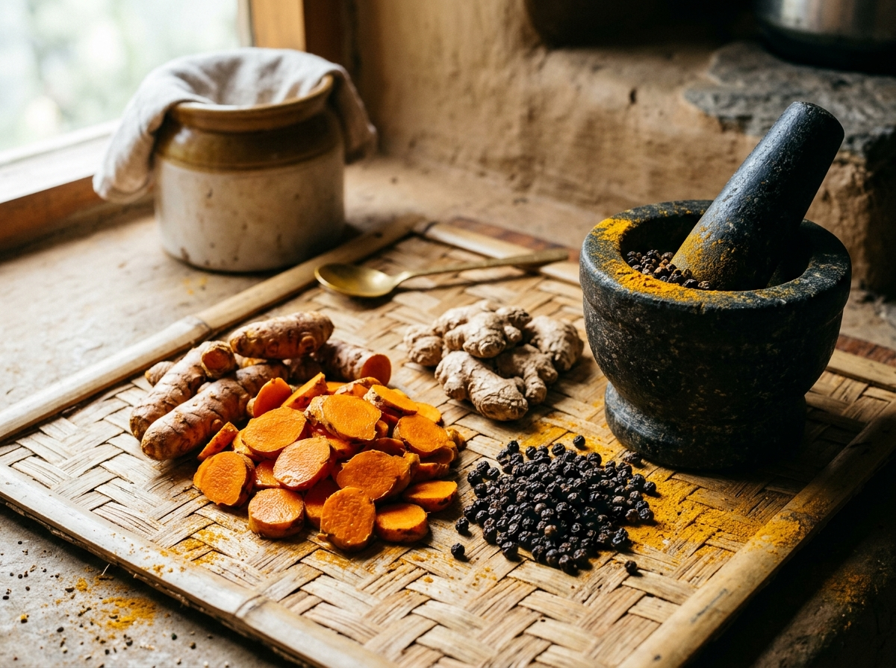
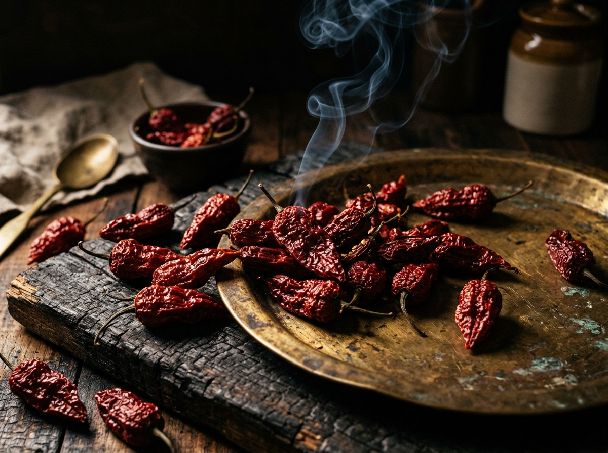

<div align="center">

# PENBRAE & CO. LTD
### *Purveyors of Single-Harvest Teas, Heirloom Rhizomes & Hearth-Smoked Chillies*
**Cardiff, Wales ↔ Northeast India**

[](https://penbrae-and-co.vercel.app)
[](./wp-content/themes/penbrae)
[-F7DF1E?style=for-the-badge&logo=javascript&logoColor=black)](./wp-content/themes/penbrae/assets/js)
[](./qa_audit_report.md)
[](./LICENSE)

<br/>


<br/>
<br/>

> *"An ingredient is never anonymous. Behind every leaf, rhizome, and smoked pod stands a landscape, an elevation, and a human hand."*

</div>

---

## ✦ Executive Summary & Design Vision

Most contemporary online tea and spice shops rely on predictable, modular e-commerce layouts that treat artisan goods as interchangeable SKUs. **Penbrae & Co** is an independent, bespoke e-commerce experience designed and built from scratch to challenge that standard.

Conceptualized as an **archival field monograph and editorial tasting room**, the site translates the tactile gravitas of high-end independent print journals (*Cereal*, *The Gentlewoman*, *Kinfolk*) into a responsive, high-performance web application. 

Every single-harvest lot is intimately bound to:
1. **The Human Hand** — Named smallholder collectives and artisan growers across Assam, Meghalaya, Nagaland, Arunachal Pradesh, and Manipur.
2. **The Terroir** — Specific micro-climates, GPS coordinates, and elevation bands ranging from 80m riverbanks to 1,980m mountain ridges.
3. **The Craft Tradition** — Ancient preservation methods including Himalayan alder-hearth smoking, bamboo-cylinder aging, and hand-rolled withered leaf.

---

## ✦ The Three Stalls (Sensory Environments)

Rather than forcing disparate ingredients into a generic catalogue, the storefront is organized into **Three Stalls**, each engineered with its own distinct palette, typography accents, and emotional tempo:

| Stall | Origin Corridor | Sensory Mood | Representative Lot |
| :--- | :--- | :--- | :--- |
| **STALL I: TEAS** | Upper Assam & Arunachal Border | *Calm, ceremonial, meditative, delicate* | **Upper Assam Tippy Orthodox Reserve** (Lot 26-A) — Late-autumn hand-rolled pluck rich in golden tips, notes of malt and heather honey. |
| **STALL II: SPICES** | West Jaintia Hills & Ziro Valley | *Warm, textured, earthy, aromatic* | **Lakadong Turmeric Reserve** (Lot 26-B) — 7.8% high-curcumin heirloom rhizomes cured on sunlit limestone uplands. |
| **STALL III: CHILLIES** | Mon District & Ukhrul Ridge | *Smoky, intense, fiery, sophisticated* | **Whole Alder-Smoked Naga King Chilli** (Lot 26-C) — 14-day hearth-cured *Capsicum chinense* balancing woodsmoke and sour cherry. |

<br/>

<div align="center">
  
  
  
</div>

---

## ✦ Key Architectural & Creative Capabilities

### 1. Zero-Bloat Vanilla Frontend Architecture
- Built with **vanilla modern JavaScript (ES6+)** and modular CSS3 custom properties — no heavy runtime frameworks (React/Vue/Next), resulting in sub-50ms paint times and zero layout shifts.
- Complete client-side smooth page navigation engine that updates document titles, Open Graph tags, canonical links, and analytics state dynamically without tearing down the audio player or map instance.

### 2. Interactive Cartographic Provenance Map
- Custom **Leaflet.js** map styled with an archival parchment cartography theme.
- Plots exact coordinates of all 5 producer collectives across Northeast India.
- Dynamic bidirectional interaction: hovering or clicking a map node illuminates the maker dossier, elevation metric, and associated single-harvest lots.

### 3. Archival Commerce Ledger & Sandbox Checkout
- **Slide-Over Basket Drawer & Dedicated Ledger Table**: Instant reactive updates with `-`/`+` quantity steppers, item removal, and live line total calculations.
- **Dynamic Weight & Price Variant Engine**: Instant switching between *Standard Lot*, *Double Reserve (+100% Weight · 8% Savings)*, and *20g Tasting Sample*.
- **Live UK Delivery Calculator**: Dynamic shipping logic (Royal Mail Tracked 48 at `£4.50`, complimentary free shipping on orders `>= £50.00`, or Express Courier at `£7.95`).
- **Sandbox Order Engine**: Simulates complete end-to-end purchasing, generates unique dispatch reference numbers (`PEN-YYYYMMDD-XXXX`), logs orders to customer account storage, and renders archival printable receipts.

### 4. Accessible Documentary Field Audio Archive (WCAG 2.2 AA)
- Dedicated field audio module designed to bring the atmosphere of the harvest into the browser.
- **Non-intrusive by design**: Zero autoplay, keyboard-accessible play/pause toggles, elapsed time scrubbers, and visible `Simulated Audio Preview` badges.
- **Verbatim Archival Transcripts**: Collapsible, screen-reader accessible full text transcripts detailing ambient sounds, weather conditions, and producer dialogues.

### 5. Contextual Provenance Compass & The Penbrae Journal
- Dynamic recommendation engine linking products to their specific growers, harvest monographs, and journal essays.
- 4 long-form editorial essays exploring the cultural anthropology and culinary science of Northeast India:
  - *Smoke, Mist & Limestone: Why Preservation Is the Second Harvest*
  - *Beyond the Breakfast Blend: Reading Whole-Leaf Orthodox Assam*
  - *Alder Trees & Jhum: The Living Agroforestry of Mon District*
  - *The Alchemy of the Tadka: Tempering Lakadong & Smoked Chilli in Mustard Oil*

### 6. Production-Grade SEO & Structured Data Graph
- Distinct, handcrafted `<title>`, `<meta name="description">`, and `<link rel="canonical">` tags for every single page.
- Rich **JSON-LD Schema Graph** injected across the platform:
  - `Organization` & `WebSite` schemas with Cardiff dispatch coordinates.
  - `CollectionPage` with integrated `BreadcrumbList` on Stall pages.
  - `Product` with live `Offer`, currency (`GBP`), availability, and SKU schemas on PDPs.
  - `Article` schemas with author, publisher, and reading times on Journal and Harvest Story pages.
- Dynamically generated `sitemap.xml` (38 canonical routes) and indexation-ready `robots.txt`.

---

## ✦ Dual-Mode Technical Stack

The project is structured with an intentional **dual-mode architecture**, allowing both client-side static presentation and full enterprise content management:

```
┌──────────────────────────────────────────────────────────────────────────┐
│                             PENBRAE & CO.                                │
├────────────────────────────────────┬─────────────────────────────────────┤
│      MODE A: STATIC / PREVIEW      │        MODE B: CMS / COMMERCE       │
│   (Vercel Edge & Node.js Engine)   │    (WordPress & WooCommerce Core)   │
├────────────────────────────────────┼─────────────────────────────────────┤
│ • preview-server/server.js         │ • wp-content/themes/penbrae/        │
│ • scripts/build-vercel.js          │ • Custom Post Types (Maker, Story)  │
│ • Zero-database static HTML builds │ • Regional Taxonomies & Meta Boxes  │
│ • 42 pre-rendered static routes    │ • Docker Compose + MariaDB Stack    │
│ • Instant edge global CDN caching  │ • Complete WooCommerce ledger hooks │
└────────────────────────────────────┴─────────────────────────────────────┘
```

---

## ✦ Directory Anatomy

```
penbrae-and-co/
├── docs/                                # Technical handover and client guides
│   ├── CLIENT-ADMIN-GUIDE.md            # CMS documentation for content editors
│   ├── ENVIRONMENT-AND-SETUP.md         # Production server requirements
│   └── PRODUCTION-CHECKLIST.md          # 20-point pre-launch deployment audit
├── preview-server/
│   └── server.js                        # High-fidelity Node.js SSR and preview engine
├── public/                              # Production static deployment bundle (42 routes)
│   ├── assets/                          # CSS design system, vanilla JS, imagery
│   ├── journal/                         # Editorial monograph static pages
│   ├── maker/                           # Producer dossier profiles
│   ├── product/                         # Single-harvest product detail pages
│   ├── stall/                           # Individual Stall environments
│   ├── story/                           # Harvest origin narrative pages
│   ├── robots.txt                       # Search engine crawler policies
│   └── sitemap.xml                      # XML indexation map (38 canonical URLs)
├── scripts/
│   └── build-vercel.js                  # Static site generation build pipeline
├── wp-content/themes/penbrae/           # Production WordPress & WooCommerce Theme
│   ├── assets/
│   │   ├── css/                         # Design system, components, and layout CSS
│   │   └── js/                          # Commerce, interactive map, and core scripts
│   ├── inc/                             # Theme setup, custom post types, custom fields
│   ├── template-parts/                  # Modular PHP components (audio, cards, hero)
│   ├── woocommerce/                     # Bespoke WooCommerce templates (cart, checkout)
│   ├── functions.php                    # Theme bootstrap and asset enqueueing
│   ├── header.php                       # Accessible masthead & basket drawer
│   └── footer.php                       # Archival colophon & Cardiff dispatch notes
├── docker-compose.yml                   # Containerized WordPress + MariaDB environment
├── package.json                         # Node scripts for preview, build, and QA
├── vercel.json                          # Clean-URL routing and static header caching
└── qa_audit_report.md                   # 12-point quality assurance audit log
```

---

## ✦ Running & Developing Locally

### Option 1: Ultra-Fast Client Preview Server (Node.js)
No database, PHP, or external dependencies required. Starts in under 2 seconds:

```bash
# Clone the repository
git clone https://github.com/Alexhzier/penbrae-and-co.git
cd penbrae-and-co

# Install dependencies (only dev utilities)
npm install

# Start local preview server
npm start
```
> Open [http://localhost:3847](http://localhost:3847) in your browser.

<br/>

### Option 2: Full WordPress + WooCommerce Stack (Docker)
Spins up a local containerized WordPress 6.6+ instance with MariaDB, WooCommerce, and the Penbrae theme pre-activated:

```bash
# Start Docker environment
docker compose up -d
```
> Open [http://localhost:8080](http://localhost:8080) in your browser.  
> Default administrative credentials and database configurations are detailed in [docs/ENVIRONMENT-AND-SETUP.md](./docs/ENVIRONMENT-AND-SETUP.md).

<br/>

### Option 3: Static Production Build (Vercel)
To rebuild the static HTML bundle and compile all 42 routes into `public/`:

```bash
# Run static generator
npm run build

# Deploy to Vercel
npx vercel --prod
```

---

## ✦ Quality Assurance & Verification Standards

A comprehensive automated QA audit was run across the codebase to ensure zero defects and complete portfolio readiness:

- [x] **Strict Stall Isolation**: Zero cross-stall contamination. Category counts and region filters strictly reflect displayed products.
- [x] **Zero Cart Hydration Mismatches**: Initial state starts at empty (`[]`, `0` items, `£0.00`). No hardcoded mock values.
- [x] **100% Link & Asset Integrity**: All internal routes, specimen imagery, and CSS/JS bundles resolve with zero 404s.
- [x] **Accessibility (WCAG 2.2 AA)**: Non-empty `alt` attributes on every image, semantic headings (`h1`–`h4`), ARIA dialog roles for drawers/modals, and keyboard focus traps.
- [x] **SEO Schema Validation**: 100% syntactically valid JSON-LD graphs verified on Google Structured Data Testing standards.

*(Detailed defect logs and resolution metrics can be reviewed in [qa_audit_report.md](./qa_audit_report.md).)*

---

## ✦ Colophon & Author

- **Concept, Design & Full-Stack Development**: [Alexhzier](https://github.com/Alexhzier)
- **Typography**: Fraunces (Editorial Display Serif), IBM Plex Sans (Body Copy), JetBrains Mono (Ledger & Metadata)
- **Color Temperature**: Natural unbleached parchment (`#F8F4EC`), carbon ink (`#1A1815`), Assam aged brass (`#8C6D3F`), terracotta (`#8A4B38`), and smoked oxblood (`#5C1E1E`).

---

## ✦ Intellectual Property & Copyright Notice

This project is an original concept and portfolio creation by **Alexhzier**. All custom design systems, layouts, editorial photography arrangements, brand storytelling, and source code are protected under copyright law:

> **Copyright © 2026 Alexhzier. All Rights Reserved.**  
> Redistribution, rehosting, unauthorized commercial exploitation, or claiming authorship of this work is strictly prohibited. Detailed terms of use are specified in [LICENSE](./LICENSE).

*Registered in Wales · Penbrae & Co. Ltd · Cardiff, UK*
